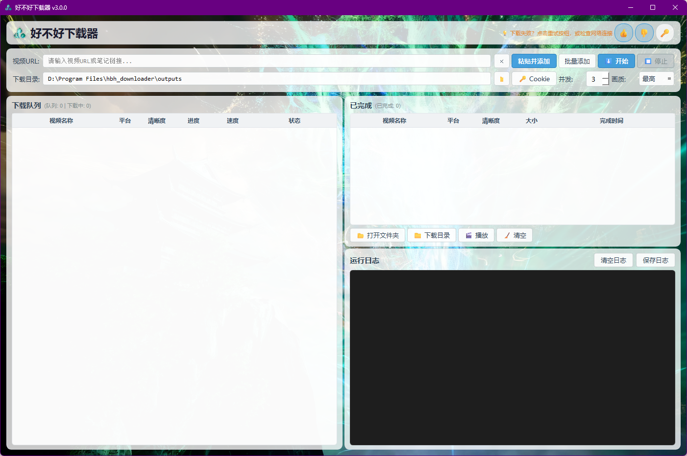

# 好不好视频下载器

面向 Windows 的多平台视频下载工具。粘贴视频链接，选择清晰度和保存目录，即可管理单个视频、批量任务与受支持的合集下载。

**当前版本：3.0.1 · Windows 10 / 11（64 位）**

本仓库用于发布桌面端安装包、使用说明与版本更新信息。

## 界面预览

## 功能特点

- **多平台解析**：支持优酷、腾讯视频、爱奇艺、B站、YouTube、抖音、快手、小红书等平台的视频链接解析。
- **清晰度选择**：按解析结果选择画质，部分视频可提供 1080P、2K、4K 等选项。
- **批量与合集下载**：批量添加链接；对于支持合集识别的平台，可选择需要下载的剧集或视频。
- **任务队列与并发管理**：设置同时下载的任务数量，查看进度、速度和状态，停止或重试任务。
- **Cookie 管理**：为需要登录的平台配置 Cookie，使用账号当前可访问的内容。
- **下载记录与日志**：查看已完成任务、打开文件夹、调用本地播放器，并保存运行日志。

具体功能因平台、视频和账号权限而异。支持某个平台，不代表该平台的所有视频与全部清晰度均可下载。

## 支持的平台

以下列出部分支持的平台：

| 分类 | 平台示例 |
| --- | --- |
| 长视频与综合视频 | 优酷、腾讯视频、爱奇艺、B站、芒果TV、搜狐视频、AcFun、1905电影网 |
| 短视频与社交 | 抖音、快手、小红书、微博、TikTok、X / Twitter |
| 新闻与公共内容 | CCTV、央视频、今日头条、微信公众号、新华网 |
| 教育与知识 | 国家中小学智慧教育平台、学习强国、CCtalk、网易公开课、TED |
| 海外视频 | YouTube、Dailymotion、Reddit、RuTube |

平台规则和接口可能变化，实际可用情况以当前版本的解析结果为准。

## 下载与安装

1. 打开本仓库的 **Releases** 页面，选择需要的版本。
2. 在该版本的 **Assets** 中下载 Windows 安装包：`hbh_downloader_Setup_3.0.1_Windows.exe`。
3. 运行安装程序，按照提示完成安装。
4. 从桌面快捷方式或开始菜单打开「好不好下载器」。

请下载 `.exe` 安装包。GitHub 自动生成的 `Source code (zip)` 和 `Source code (tar.gz)` 仅包含本发布仓库的说明文件，不是可运行的软件。

安装版无需自行安装 Python。部分平台功能需要可用的浏览器、登录状态或相应网络环境。

## 快速开始

1. **选择下载目录**：在主界面设置视频保存位置。
2. **添加视频链接**：复制视频网址，点击「粘贴并添加」；多个链接可使用「批量添加」。
3. **确认下载内容**：如果识别到合集，按提示选择需要的内容。
4. **选择画质和并发数**：可使用「最高」画质，或选择需要的清晰度。
5. **开始下载**：点击「开始」，在任务队列中查看进度。
6. **查看文件**：下载完成后，在右侧列表选中任务，打开文件夹或播放视频。

需要登录的平台，可先点击主界面的「Cookie」进行配置。如果程序提示授权未激活、次数不足或功能需要高级授权，请按界面提示查看授权状态；账号会员权限与软件授权分别管理。

## 常见问题

### 浏览器能播放，软件却提示登录或人机验证？

浏览器的登录状态不会自动等同于软件中的 Cookie。请确认浏览器已登录对应平台，再在软件的 Cookie 管理中更新完整 Cookie。登录状态过期后需要重新配置。

YouTube 等平台还会检查网络环境。请保持解析和下载使用一致、稳定的网络或代理，更新 Cookie 后重新添加任务。

### 为什么没有 1080P 或 4K？

画质取决于视频原始规格、平台提供的格式、账号权限和当前可用的下载通道。「最高」表示本次解析可用的最高画质，不代表所有视频均可下载到 4K。

### 会员视频和加密视频都能下载吗？

仅在账号有相应访问权限、且当前下载通道支持时可用。部分平台的加密格式无法通过现有通道导出，程序可能拒绝下载。会员身份和浏览器可播放状态均不保证文件可下载。

### 下载失败，应该怎样排查？

先检查链接是否有效、浏览器能否正常播放，以及 Cookie 和网络是否可用。对于较早添加的任务，删除后重新解析，避免继续使用过期的媒体地址。仍然失败时，可保存日志并提交反馈。

### 为什么安装包比较大？

安装包包含桌面运行环境、视频处理及下载所需的组件，用于减少手动安装依赖的步骤。

## 问题反馈

请通过本仓库的 **Issues** 提交问题，并尽量提供：

- 软件版本和 Windows 版本；
- 平台名称、视频链接、所选清晰度；
- 操作步骤、错误提示，以及相关日志或截图；
- 浏览器能否正常播放，以及是否配置了登录 Cookie。

提交前请移除 Cookie、授权码、访问令牌、个人账号信息和带签名的媒体直链，不要公开这些内容。

## 致谢与许可

本软件基于 CharlesPikachu / Zhenchao Jin 的 [videodl](https://github.com/CharlesPikachu/videodl) 项目进行开发，并使用 yt-dlp、FFmpeg、N_m3u8DL-RE、aria2、BBDown、lux 等第三方组件。

原项目采用 **PolyForm Noncommercial License 1.0.0**，许可文本见本仓库的 [LICENSE](./LICENSE)。第三方组件分别适用各自的许可证，其许可要求不因本仓库仅提供安装包而改变。

请仅下载自己拥有权利或已获授权的内容，并遵守相应平台的使用条款。
